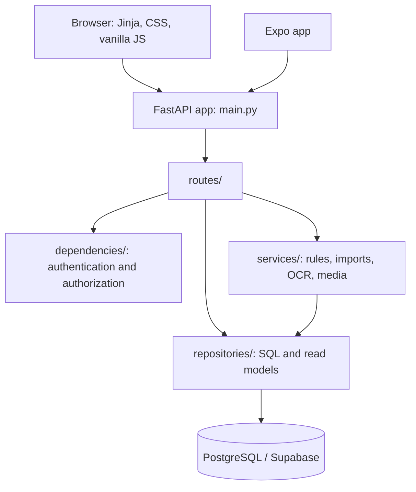
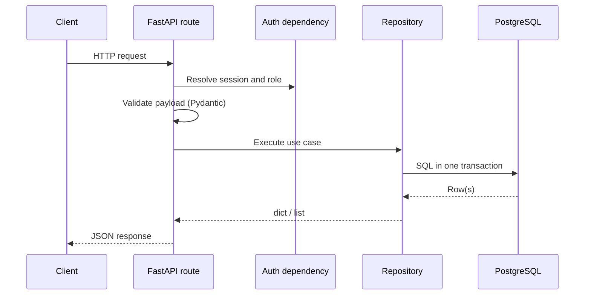
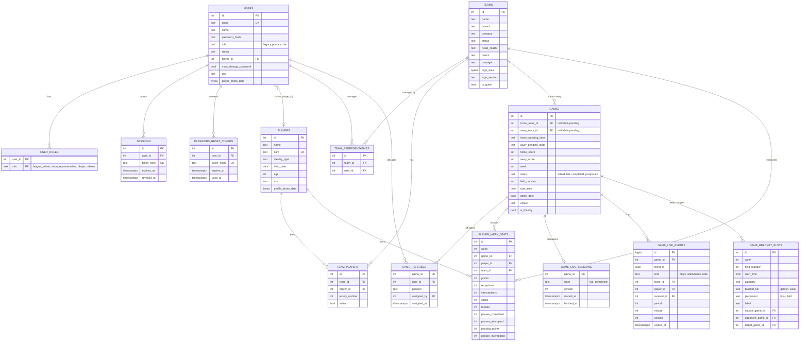

# Flagtastic Architecture

Flagtastic runs the FlagTastic flag-football league: teams and rosters,
player and referee accounts, schedules, live game capture, standings,
statistics, leaderboards, playoffs and finals eligibility. It is a
deliberately lightweight layered FastAPI monolith on PostgreSQL (Supabase),
deployed to Vercel, with an Expo mobile client.

## Architectural Goals

- Keep the HTTP API simple and predictable; enforce every authorization rule
  on the server.
- Separate input contracts, HTTP handling, domain services and SQL.
- Model players as reusable people across multiple teams.
- Protect critical integrity rules at the database level.
- Keep league rules visible and covered by tests.

## Overview

The web application is the complete operational product. The Expo client in
`mobile/` offers focused views for three roles: players (home, standings,
leaders, personal statistics), referees (home, agenda, history) and team
representatives (home, teams, games, standings), plus a profile tab for role
switching and sign-out. Actions outside that scope open the web application.
Both clients share the same FastAPI API, authorization rules, PostgreSQL data
and media.

Native authentication uses `POST /api/auth/mobile/login`. It accepts accounts
carrying at least one of the `player`, `referee` or `team_representative`
roles, rejects accounts that must still change their password, and returns the
same revocable database session used by browsers as a 12-hour Bearer token.
Protected dependencies resolve either the secure browser cookie or an
`Authorization` header; there is no parallel authorization path. The client
stores the token in Expo SecureStore and never persists a password.

## Layers

- **Application** (`main.py`): creates the app, registers routers, serves
  pages, `/media/profiles/{filename}`, `/live` and `/ready`.
- **Contracts** (`models.py`): Pydantic models for request payloads (teams,
  players, games, friendly games, schedule imports, accounts, passwords).
- **Dependencies** (`dependencies/auth.py`): resolve the session from cookie or
  Bearer token and enforce `require_league_admin`, `require_team_manager`
  (assigned team only, with the roster cutoff), `require_score_recorder`
  (administrators and referees), `require_referee`, `require_player`, and
  others. They return `401`/`403` regardless of what the frontend shows.
- **Routes** (`routes/`): HTTP validation and error translation.
- **Services** (`services/`): domain rules and parsers.
- **Repositories** (`repositories/`): SQL, transactions and read models.
- **Database** (`database.py`): psycopg connections from `DATABASE_URL`
  (required; startup fails without it).
- **Schema history** (`migrations/`): Alembic migrations; see
  [Schema changes](#schema-changes).

| Router | Responsibility |
|---|---|
| `routes/auth.py` | Registration, web and mobile login, current user, password change/reset, logout |
| `routes/teams.py` | Teams, logos, staff, status, names, representatives, duplicate audit |
| `routes/players.py` | Roster reads, registration, existing-player search, CSV/XLSX import, edits, photos, deactivation |
| `routes/games.py` | Games, schedule imports, referee-role imports, officials, scores, scheduling, status, deletion |
| `routes/live_games.py` | Live capture, corrections, finalization and attendance check-in |
| `routes/standings.py` | Division standings |
| `routes/statistics.py` | Statistics imports, player totals and profiles, leaderboards |
| `routes/dashboard.py` | Player and representative dashboards, player AKA, self-service team membership |
| `routes/referees.py` | Referee directory, profiles, self-service AKA/photo, admin assignment audit |
| `routes/admin.py` | Account and role administration |
| `routes/admin_finals_eligibility.py` | Finals attendance eligibility report |

| Service | Responsibility |
|---|---|
| `auth.py` | Credential checks and session-backed identity |
| `curp.py` | Birth date and completed age from CURP or provisional birth date |
| `divisions.py` | Canonical divisions; unified U8–U12 cross-branch rules |
| `team_matching.py` | Matching abbreviated upload labels to registered teams |
| `game_schedule_import.py`, `schedule_context.py` | Game calendar parsing (XLSX, CSV, image, browser OCR words), dates and venues, bracket slots |
| `referee_schedule_import.py`, `referee_schedule_ocr.py` | Referee-role parsing from XLSX/CSV and server-side image OCR |
| `statistics_import.py` | Official statistics workbook parsing |
| `roster_import.py`, `roster_policy.py` | Roster file parsing; representative roster cutoff |
| `live_game.py` | Projection of live events into score and statistics |
| `bracket_advancement.py` | Filling pre-created playoff games from feeder results |
| `standings_adjustments.py` | Explicit league-approved standings credits |
| `profile_photos.py`, `logo_thumbnails.py` | Image validation and display derivatives |
| `email.py` | Password-reset email through Resend |

Repositories are grouped by resource: `teams`, `players`, `games`,
`live_games`, `statistics`, `standings`, `users`, `sessions`,
`password_resets`, `referees`, `dashboard` (player dashboard and public
profile), `representative_dashboard`, `finals_eligibility` and
`regular_season` (shared regular-season SQL).

## Request Flow

Example, registering a roster player (`POST /api/teams/{team_id}/players`):
the dependency checks that the caller manages the team and the roster is open;
`PlayerCreate` validates the body; the repository finds or creates the player
identity by CURP, rejects a second active membership in the same division or a
duplicate jersey, and inserts `team_players`; conflicts become `409`.

## Data Model

Players are people; teams belong to one branch and category; `team_players`
is the membership; `player_week_stats` stores one row per jornada, player,
team and game. Live and imported attendance are `attendance` rows in
`game_live_events`. Row Level Security is enabled on application tables as
defense in depth; FastAPI remains the only data path.

## Domain Rules

### Teams

- Identity is the normalized name + branch + category. Display casing is
  kept; a case-insensitive expression index prevents `Ravens` and `RAVENS` in
  the same division.
- New teams start `pending`; administrators move them among `pending`,
  `active` and `inactive`.
- U8, U10 and U12 are one **Infantiles** division per category: new teams are
  stored as `mixto`, historical teams keep their stored branch, games may cross
  branches, and standings and leaderboards combine every branch. Older
  categories require a branch.
- Guest teams (`is_guest`) exist only for friendly games and are excluded from
  standings and statistics imports.
- An administrator-only audit lists possible duplicate names across
  divisions; it never merges or deletes.

### Players and rosters

- CURP uniquely identifies a person and is private. A provisional identity
  (shorter identifier plus explicit birth date) is also supported; see
  [`provisional-player-identities.md`](provisional-player-identities.md).
- Age is completed years as of today, derived from the CURP birth date or the
  provisional birth date.
- A player may be on teams of different divisions, but not on two active
  teams of the same division. Jersey numbers are unique per team.
- Removing a player soft-deactivates the membership; identity, login and
  statistics remain, and re-adding reactivates it.
- Representatives may change rosters only for teams linked to them in
  `team_representatives`, and only until **October 16, 2026 00:00
  America/Mexico_City** (`services/roster_policy.py`, decided by server
  time). Administrators keep write access. Reads are unaffected.
- Bulk imports accept up to 100 players from CSV (comma or semicolon) or XLSX
  with `nombre`, `curp`, `numero` (legacy `edad` accepted), in one
  transaction.

### Games and schedule

- A game has a home and away team from the same division (cross-branch in
  U8–U12), or two pending labels for a pre-created playoff game.
- Status moves from `scheduled` to `completed` when a non-tied final score is
  saved by an administrator, a referee, or live-capture finalization.
  Administrators may postpone and restore unplayed games; postponed games
  reject scores. Only administrators may change an existing score.
- `PATCH /api/games/{id}/schedule` moves a fixture's time/field (and
  date/venue) while keeping its ID, crew, statistics and live session.
- Friendly games (`is_friendly`) may include guest teams and are excluded
  from standings, statistics imports and finals eligibility.
- Deleting a game cascades referee assignments; statistic rows keep their
  data with the game link cleared.
- Schedule imports and their review rules are described in
  [`game-schedule-import.md`](game-schedule-import.md) and
  [`calendar-dates-and-venues.md`](calendar-dates-and-venues.md).

### Playoffs

Final and third-place games are pre-created with pending labels and filled
automatically when both semifinals have final scores. See
[`playoff-advancement.md`](playoff-advancement.md).

### Statistics

- Statistics come from the official workbook import or live-capture
  finalization. The import only links statistics to existing games; it never
  creates games or writes scores. Unresolved teams, games and jersey numbers
  are skipped and reported. See [`statistics-upload.md`](statistics-upload.md).
- Live capture is described in [`live-games.md`](live-games.md). Live capture
  records the interceptor, not the thrower, so `passes_intercepted` stays 0 for
  live-captured games.
- Player names shown publicly always come from `players`, never from imported
  text.

### Leaderboards

`GET /api/statistics/leaderboards?branch=&category=` returns the top five per
metric for one division. In unified U8–U12 a player on several rosters appears
once, with her best team record; records are never summed. Ties use the
documented secondary metrics, then player ID and team ID.

| Metric | Leaderboard |
|---|---|
| Quarterback index (`passer_rating`) | El Francotirador |
| Receptions | Manos de Acero |
| Points | Maquina de Puntos |
| Tackles | El Muro |
| Interceptions | Cazador Aereo |
| Sacks | Cazador de QBs |

The quarterback index (0–100) is the average of three components, each from 0
to 1:

- precision = completions ÷ attempts;
- productivity = (passing points ÷ completions) ÷ 2.5, capped at 1;
- safety = 1 − (interceptions thrown ÷ attempts) ÷ 10%, floored at 0.

A QB needs at least 50 cumulative attempts in the division at all times; there
is no early-season exemption. The response also keeps `completion_percentage`
(same 50-attempt rule) for installed app versions. Passing points and thrown
interceptions were added in migration `c5e2a7f19d30` (SQL twin
`docs/sql/add-quarterback-passing-stats.sql`).

### Finals eligibility

Administrators review `/admin/finals-eligibility`, backed by
`GET /api/admin/finals-eligibility` (`league_admin` only). It lists active
roster players who attended fewer than ⌊games ÷ 2⌋ + 1 of their team's
regular-season games (6 games → 4).

- Regular season (`repositories/regular_season.py`): non-friendly,
  non-postponed games between teams of the same category, in jornadas before
  the first jornada that holds a bracket slot, excluding bracket target games.
- Attendance: non-voided `attendance` events from live check-in or the
  statistics import, on `completed` games. Two games in one jornada count as
  two.

The live-game attendance panel uses the same regular-season rule.

## Authorization

Roles are cumulative in `user_roles` (`league_admin`, `team_representative`,
`player`, `referee`); the legacy `users.role` column is kept but checks use
the full set. Sessions store only a SHA-256 hash of a random token; cookies are
`HttpOnly`, `SameSite=Lax` and `Secure` unless `SESSION_COOKIE_SECURE=false`.
Staff accounts created by administrators start with `must_change_password`;
protected dependencies reject their session until the password is replaced.
Public responses never include CURP, email, roles, hashes or tokens.

- **Players** claim an existing roster identity at registration when CURP,
  legal name and age match; otherwise a new identity is created. Dashboards
  are resolved from the session, never from a browser-supplied ID.
- **Representatives** create teams (and are linked automatically) and manage
  only linked teams. Administrators link or unlink representatives for older
  teams; ownership is never guessed.
- **Referees** see only their own assignments (with the full crew), may record
  final scores, and are the only role that can run live capture. Their AKA and
  photo appear in the private referee directory; player-referees reuse their
  player photo.
- **League administrators** manage teams, accounts and roles (they cannot
  demote or delete themselves), schedules, officials, imports and corrections.
  Deleting an account revokes access but keeps the linked player history.

Game detail responses follow least privilege: everyone sees teams, jornada,
time, field and score; players see their own row; representatives see their
teams' rows; referees see the crew; administrators see both. Unauthorized
sections are omitted, not returned empty.

`game_referees` stores one row per game and official with `position`
(Referee, Down Judge, Field Judge, Side Judge, Statistician). Imports require
Referee and Down Judge; the others are optional. Assigning an occupied
position replaces it atomically.

## Current Endpoints

Interactive documentation is served at `/docs` and `/redoc`. Unless noted,
writes require the role named in the description.

| Method | Path | Description |
|---|---|---|
| `GET` | `/live` | Process liveness check |
| `GET` | `/ready` | PostgreSQL readiness; `503` without details on failure |
| `GET` | `/media/profiles/{filename}` | Profile photo, immutable cache headers |
| `POST` | `/api/auth/register/player` | Player self-registration with required photo |
| `POST` | `/api/auth/login` | Web login; sets the session cookie |
| `POST` | `/api/auth/mobile/login` | Mobile login for players, referees and representatives; returns a Bearer token |
| `GET` | `/api/auth/me` | Current user for a cookie or Bearer session |
| `POST` | `/api/auth/change-password` | Change password, including the mandatory first change |
| `POST` | `/api/auth/forgot-password` | Account-neutral response; emails a reset link when eligible |
| `POST` | `/api/auth/reset-password` | Consume a single-use token and revoke existing sessions |
| `POST` | `/api/auth/logout` | Revoke the current session |
| `POST` | `/api/teams` | Create a team (representatives and administrators) |
| `GET` | `/api/teams` | List teams |
| `GET` | `/api/teams/{team_id}` | Team with public roster, `can_manage`, roster cutoff fields |
| `GET` | `/api/teams/{team_id}/logo` | Team logo |
| `PUT` | `/api/teams/{team_id}/logo` | Replace logo; team managers |
| `PATCH` | `/api/teams/{team_id}/staff` | Head Coach, Coach, Manager; team managers |
| `PATCH` | `/api/teams/{team_id}/status` | Pending/active/inactive; administrators |
| `PATCH` | `/api/teams/{team_id}/name` | Correct the team name; administrators |
| `PUT` | `/api/teams/{team_id}/representatives/{user_id}` | Link a representative; administrators |
| `DELETE` | `/api/teams/{team_id}/representatives/{user_id}` | Unlink a representative; administrators |
| `GET` | `/api/teams/representative-assignments` | Current team ownership; administrators |
| `GET` | `/api/teams/duplicate-candidates` | Possible duplicate team names; administrators |
| `DELETE` | `/api/teams/{team_id}` | Delete a team; administrators |
| `GET` | `/api/teams/{team_id}/players` | Public roster |
| `POST` | `/api/teams/{team_id}/players` | Register a roster player; team managers |
| `GET` | `/api/teams/{team_id}/players/candidates` | Search existing player identities by name or AKA; team managers |
| `POST` | `/api/teams/{team_id}/players/registered` | Add an existing identity to the roster; team managers; representatives must send its `curp` |
| `POST` | `/api/teams/{team_id}/players/import` | CSV/XLSX roster import; team managers |
| `GET` | `/api/teams/{team_id}/players/import/template.csv` | Roster import template |
| `GET` | `/api/teams/{team_id}/players/{player_id}/management` | Private identity fields; team managers |
| `PATCH` | `/api/teams/{team_id}/players/{player_id}` | Correct identity and jersey; team managers (identity only administrators when the player has an account or another active roster) |
| `PUT` | `/api/teams/{team_id}/players/{player_id}/photo` | Replace a player photo; team managers (same identity rule) |
| `DELETE` | `/api/teams/{team_id}/players/{player_id}` | Deactivate the membership; team managers |
| `GET` | `/api/me/dashboard` | Player dashboard |
| `PATCH` | `/api/me/profile` | Player AKA |
| `POST` | `/api/me/teams/{team_id}` | Player joins one team per division; closed after the roster cutoff |
| `GET` | `/api/me/representative-dashboard` | Dashboard scoped to the representative's teams |
| `POST` | `/api/games` | Create a game or friendly game; administrators |
| `GET` | `/api/games` | List games with scores and pending labels |
| `GET` | `/api/games/calendar-capabilities` | Whether date/venue columns are active |
| `GET` | `/api/games/{game_id}/details` | Role-scoped game detail |
| `GET` | `/api/games/mine/referee` | The referee's own assignments with full crews |
| `POST` | `/api/games/schedule/analyze` | Parse an XLSX, CSV or image calendar into proposals without writing |
| `POST` | `/api/games/schedule/analyze-ocr` | Match browser OCR words to teams |
| `POST` | `/api/games/schedule/analyze-cells` | Match browser OCR grid cells to teams |
| `POST` | `/api/games/schedule/confirm` | Create reviewed games and bracket slots atomically |
| `POST` | `/api/games/referee-schedule/analyze` | Parse an image, XLSX or CSV referee role into proposals without writing |
| `POST` | `/api/games/referee-schedule/confirm` | Replace officials for reviewed games |
| `GET` | `/api/games/{game_id}/referees` | Crew of a game; administrators |
| `PUT` | `/api/games/{game_id}/referees/{user_id}` | Assign or replace an official; administrators |
| `DELETE` | `/api/games/{game_id}/referees/{user_id}` | Remove an official; administrators |
| `PATCH` | `/api/games/{game_id}/score` | Record a final score; administrators and referees |
| `PATCH` | `/api/games/{game_id}/schedule` | Move time/field/date/venue; administrators |
| `PATCH` | `/api/games/{game_id}/status` | Postpone or restore; administrators |
| `PATCH` | `/api/games/week/{week}/status` | Postpone or restore a jornada; administrators |
| `DELETE` | `/api/games/{game_id}` | Delete one game; administrators |
| `DELETE` | `/api/games/week/{week}` | Delete a jornada after explicit confirmation; administrators |
| `GET` | `/api/games/{game_id}/live` | Public live snapshot and play feed |
| `POST` | `/api/games/{game_id}/live/start` | Start capture; referees |
| `POST` | `/api/games/{game_id}/live/events` | Add an idempotent play; referees |
| `POST` | `/api/games/{game_id}/live/events/{event_id}/void` | Void a play (administrators after completion) |
| `POST` | `/api/games/{game_id}/live/finish` | Publish score and statistics; administrators and referees |
| `POST` | `/api/games/{game_id}/live/cancel` | Cancel an accidental capture; administrators |
| `POST` | `/api/games/{game_id}/live/attendance` | Attendance check-in without starting capture |
| `GET` | `/api/standings` | Standings for one division; U8–U12 combine branches |
| `GET` | `/api/statistics/import-template` | Compact statistics template; administrators |
| `POST` | `/api/statistics/import` | Import every `Wk` sheet, linking to existing games only; administrators |
| `POST` | `/api/weeks/{week}/player-stats/import` | Import one jornada, linking to existing games only; administrators |
| `POST` | `/api/weeks/{week}/player-stats/import-division` | Import one jornada and division; administrators |
| `GET` | `/api/weeks/{week}/player-stats` | A jornada's individual statistics |
| `GET` | `/api/players/{player_id}/stats` | Player totals, optionally per team |
| `GET` | `/api/players/{player_id}/profile` | Public player profile |
| `GET` | `/api/statistics/leaderboards` | Top five per metric for one division |
| `GET` | `/api/referees` | Referee directory; signed-in users |
| `GET` | `/api/referees/me` | The referee's own directory profile |
| `PATCH` | `/api/referees/me` | The referee's AKA |
| `PUT` | `/api/referees/me/photo` | The referee's photo |
| `GET` | `/api/referees/assignments` | Every official's games; administrators |
| `GET` | `/api/referees/{user_id}` | Aggregate referee profile; signed-in users |
| `GET` | `/api/admin/users` | Accounts for role administration |
| `POST` | `/api/admin/users` | Create a staff account (no `player` role) |
| `PATCH` | `/api/admin/users/{user_id}/role` | Grant or revoke one role |
| `PUT` | `/api/admin/users/{user_id}/roles` | Replace the role set |
| `POST` | `/api/admin/users/{user_id}/reset-password` | Issue a temporary password |
| `POST` | `/api/admin/users/{user_id}/recover-account` | Replace a compromised email and credentials |
| `PATCH` | `/api/admin/users/{user_id}/referee-aka` | Maintain an official's AKA |
| `DELETE` | `/api/admin/users/{user_id}` | Delete another account, keeping player history |
| `GET` | `/api/admin/finals-eligibility` | Players below the finals attendance threshold |

The password-recovery endpoints work, but the login page does not link to
`/forgot-password` until a league-owned sending domain is verified in Resend.

## Current Web Pages

| Path | Description |
|---|---|
| `/` | Redirects to `/teams` |
| `/teams` | Team directory |
| `/teams/{team_id}/roster` | Team roster and, for managers, roster management |
| `/teams/{team_id}/manage` | Administrator change center for one team |
| `/games` | Schedule with filters, weekly featured result, schedule imports and the administrator schedule board |
| `/games/{game_id}` | Game detail with live scoreboard, play feed, field view, attendance and crew |
| `/standings` | Division standings |
| `/statistics` | Leaderboards and the administrator statistics import |
| `/players/{player_id}` | Public player profile |
| `/login`, `/register`, `/change-password` | Authentication |
| `/forgot-password`, `/reset-password` | Password recovery |
| `/dashboard` | Player dashboard |
| `/representative-dashboard` | Representative dashboard |
| `/referee/games` | Referee dashboard and administrator referee-role import |
| `/referees`, `/referees/{user_id}` | Referee directory and profiles (signed-in users) |
| `/admin/users` | Account and role administration |
| `/admin/team-duplicates` | Duplicate team audit |
| `/admin/finals-eligibility` | Finals eligibility report |
| `/privacy` | Privacy notice |

## Frontend

Server-rendered Jinja templates (`templates/`) with one vanilla JavaScript
file per page in `static/`. Shared layout lives in `base.html`,
`static/layout.js`, `static/style.css` and `static/ui.css`; page scripts never
compute viewport sizes. Below `820px` the sidebar becomes a modal drawer,
controls keep 44px touch targets and wide tables scroll inside their own
wrappers (`.standings-table`, `.users-table-wrapper`, `.table-scroll`).

- Every team name rendered as navigation links to `/teams/{team_id}/roster`.
- The games page keeps one API snapshot and filters it locally by team,
  jornada, division and field.
- Imports show real progress for file reading/preparation and upload
  (`static/import_progress.js`), then a processing stage.
- Game-calendar images are read in the browser with Tesseract.js
  (`static/ocr_loader.js`); the server only matches the recognized words.
  Referee-role images use server-side Tesseract.
- Analytics: [`analytics.md`](analytics.md). UI conventions:
  [`ui-system.md`](ui-system.md).

## Media and Upload Limits

Profile photos and team logos are stored in PostgreSQL so they survive
stateless deployments. Logo URLs carry an MD5 content version and photo
filenames change on replacement, so both are served with one-year immutable
cache headers; collection views lazy-load images.

Vercel rejects request bodies over 4.5 MB before FastAPI runs. Server-side
limits are higher:

| Upload | Server limit |
|---|---|
| Statistics workbook | 15 MiB |
| Game calendar (XLSX, CSV, image) | 15 MiB, 500 games |
| Referee role (image, XLSX, CSV) | 10 MiB, 500 rows |
| Roster import | 5 MiB, 100 players |
| Profile photo, referee photo | 5 MiB |
| Team logo | 5 MiB |

The browser shrinks statistics workbooks above 4 MiB (see
[`statistics-upload.md`](statistics-upload.md)) and re-encodes registration
profile photos above 3 MB to a 1600-pixel JPEG. Every other upload is sent
as-is, so on Vercel it is effectively limited to under 4.5 MB. A platform
`413` produces a size message in the UI.

## Configuration and Deployment

Configuration is read from environment variables (see the README). Production
and Vercel Preview use separate Supabase projects; Preview's `DATABASE_URL`
points to `flagtastic-league-preview`, which holds only test data. Every
branch and pull request gets a Preview deployment; merging to `main` deploys
Production.

The `Dockerfile` (`python:3.14-slim` with `tesseract-ocr`) runs
`uvicorn main:app --host 0.0.0.0 --port 8000`; CI builds it and publishes
images for `main` to GHCR.

### Schema changes

Vercel never runs migrations. Each schema change is applied to Preview and
then Production **before** merging code that reads it, by either:

1. `python -m alembic upgrade head` with the database owner credentials, or
2. for additive changes, the idempotent SQL twin in `docs/sql/` run in the
   Supabase SQL editor.

Migrations meant to be applied through the SQL editor must be idempotent and
ship with that twin. Never downgrade Preview or Production: several
downgrades delete data. Fix forward instead. The current head is
`c5e2a7f19d30`.

## Delivery

GitHub Actions runs on pull requests to `main` and pushes to `main`:

- **Test**: installs `requirements-dev.txt`, compiles Python, runs Alembic
  upgrade/downgrade/upgrade on a disposable PostgreSQL 18 service, runs
  `pytest` and `node --test tests/js/*.test.cjs`.
- **Docker**: builds the image; pushes to GHCR only outside pull requests.
- **Mobile**: `npm ci`, `node --test tests/*.test.mjs`, `npm run typecheck`
  and `npx expo-doctor` in `mobile/`.
- **Live capture browser**: Playwright/Chromium scripts in `tests/browser/`
  with mocked API responses.
- **CodeQL**: Python analysis (also weekly).

Images are tagged with the short commit SHA and branch; deployments should
prefer immutable tags over `latest`.

## Observability

`observability.py` configures privacy-safe JSON logs, optional Sentry (only
when `SENTRY_DSN` is set), release tags and request IDs. Every response
includes `X-Request-ID`. Better Stack polls `/live` and `/ready`. Details are
in [`observability.md`](observability.md).

## Conventions and Risks

- Routes handle HTTP errors; repositories own SQL and transactions; services
  own parsing and cross-repository rules.
- Imports that write data run in one transaction and lock what they need, so
  a rejected file leaves no partial changes.
- The database keeps constraints that must not depend only on application
  code.
- Schema changes must reach Preview and Production before dependent code is
  merged; a merge deploys immediately.
- The roster cutoff is a code constant; another season needs a code change.
- Every roster write that checks "one player per branch and category" takes
  the same `team_players` table lock, so concurrent joins cannot place one
  player on two teams of a division.
- Scripts in `scripts/` have no Production guard; run them only against local
  or Preview databases.
